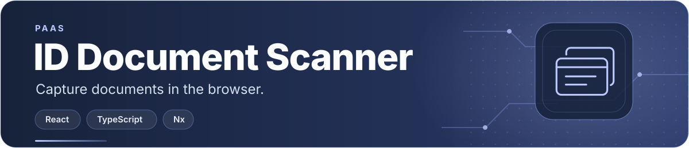

# 

A browser app with a camera view and video analysis for document capture. Use sample documents when developing and testing the capture flow.

[Project website](https://svazqz.github.io/id-docu-scanner/)

[](https://github.com/svazqz/id-docu-scanner/actions/workflows/ci.yml)

[Quick start](#quick-start) · [Validation](#validation) · [Project layout](#project-layout)

## Quick start

Use pnpm 8 with the checked-in lockfile.

```sh
pnpm install --frozen-lockfile
pnpm start
```

Open the local URL printed by Nx and allow camera access when exercising the capture flow.

## Validation

```sh
pnpm test
pnpm build
```

Use a simulated camera feed or sample images for repeatable checks.

## Project layout

| Path | Purpose |
| --- | --- |
| [`src/app/`](src/app/) | Application UI and camera analysis |
| [`e2e/`](e2e/) | Cypress end-to-end checks |
| [`project.json`](project.json) | Nx targets |

## License

Original project code is available under the [MIT License](LICENSE). Third-party components retain their own terms.

See [third-party notices](THIRD_PARTY_NOTICES.md) for bundled or external dependencies.
